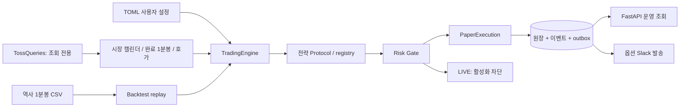

# 현재 아키텍처

기존 OAuth 및 조회 API를 재사용하고, 증권사 조회와 독립적인 전략·리스크·PAPER 엔진을 추가했습니다.
아래 트리의 각 파일이 구현되어 있습니다.

```text
config/strategy.toml          # 사용자 종목·전략·리스크 파라미터
src/toss_trading/
├── config.py                # 환경변수·Secrets; 실거래 활성화 거부
├── trading_config.py        # TOML 스키마·안전 한도
├── domain.py                # Decimal, 완료 분봉, 호가, 세션, 포지션, 주문 상태
├── strategy.py              # 순수 지표 계산·신호·명시적 전략 registry/Protocol
├── risk.py                  # 진입 검증·ATR 수량·노출/현금 예약 고려
├── execution.py             # Execution 계약·PaperExecution·차단된 LIVE 경계
├── engine.py                # 이벤트 처리·청산 우선순위·신호 중복 방지
├── persistence.py           # SQLite/PostgreSQL 원장·판단 이벤트·Slack outbox
├── marketdata.py            # 공식 캘린더/호가/분봉 해석·역사 거래일 캘린더
├── runner.py                # 공식 REST 기반 PAPER poll 실행
├── reconciliation.py        # 실제 계좌와 기대 상태를 읽기 전용으로 대조
├── download.py              # 지정 종목의 공식 과거 1분봉 CSV 다운로드
├── backtest.py              # 동일 엔진 재생·학습/검증 분리·성과·Buy & Hold
├── notifications.py         # 명시적으로 켠 Slack outbox dispatcher
├── api.py                   # 기존 조회 API + 모의 상태/이벤트 조회
├── ports.py                 # 기존 BrokerQueries 계약
├── smoke.py                 # 기존 실제 조회 연결 점검
└── adapters/toss.py          # 기존 OAuth·조회 + 공식 분봉/호가/캘린더 GET
examples/generate_synthetic.py
```



PAPER는 실제 계좌와 별개인 모의 현금/포지션/주문만 사용합니다. 전략은 키·HTTP·LLM에
접근하지 않습니다. 설정 목록 밖의 신호는 엔진과 실행 어댑터 모두에서 거부합니다.
향후 전략 추가는 Strategy Protocol을 구현하고 명시적 registry에 등록하는 방식입니다.
외부 패키지나 추천 종목을 자동 발견·설치하지 않습니다.

원장은 SQLAlchemy를 통해 JSON aggregate로 저장합니다. 한 step의 상태·판단 기록·알림을
같은 트랜잭션에 기록하고 revision 조건 갱신으로 동시 worker의 이중 반영을 막습니다.
주문 식별자는 거래일·종목·신호 봉에서 결정되어 재시작 이후에도 유지됩니다.
DB 트랜잭션 외부로 실주문을 보내지 않기 때문에 PAPER에서는 commit 실패가 실계좌에 영향을 주지 않습니다.

모의 체결은 이후의 timestamp를 가진 신선한 호가에서만 발생합니다. 같은 호가를 반복해서
부분 체결시키지 않습니다. 체결 대기 상태와 UNKNOWN은 같은 종목의 다음 주문을 막습니다.
손절/종료 청산 시 미체결 매수 잔량을 확정 취소한 후 현재 보유 수량만 청산합니다.
LIVE의 취소 확인·타임아웃·분산 상태 조정은 PAPER 동작을 그대로 가정해서 활성화하지 않습니다.

## 다음 운영 단계

1. 발급된 키와 허용 IP에서 조회·캔들 timestamp·호가 신선도·누락·retention을 확인합니다.
2. 실제 과거 데이터로 독립 학습/검증을 수행하고 PAPER를 정규장 동안 운용합니다.
3. PostgreSQL 운영 마이그레이션·백업/복원, WebSocket 수집, 공유 토큰과 호출 한도 관리를 검증합니다.
4. LIVE 어댑터의 브로커 orderId 매핑·멱등성·잔고/체결 재조정·보호 주문·정규장 종료 취소를 별도 구현/검증합니다.
5. 검증 증거와 독립 활성화 조건을 갖춘 뒤 LIVE 전환을 설계합니다. 현재는 설정만으로 활성화할 수 없습니다.
6. Lightsail 배포 승인·CD·React 대시보드를 추가합니다. 기존 CI와 Compose는 유지했습니다.

운영 DB를 변경할 때 aggregate schema version, 데이터 마이그레이션과 롤백을 함께 설계해야 합니다.
현재 metadata.create_all은 초기 스키마 생성만 담당하며 기존 DB 변경을 자동 수행하지 않습니다.
